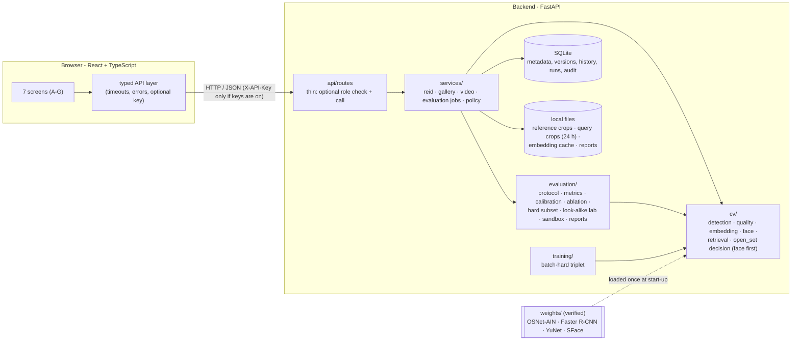

# Architecture and design decisions

## 1. The system in one picture



The two arrows that matter most: **`Eval → CV`** (the evaluation calls the *same* ranking code as the live system, so what is measured is what is served) and **`Weights ⇢ CV`** (models are loaded once, from checked files, never fetched at run time).

## 2. One query, step by step

```mermaid
sequenceDiagram
  participant B as Browser
  participant R as route /api/reid/predict
  participant S as reid_service
  participant D as detector
  participant E as embedder (OSNet)
  participant F as face engine (YuNet + SFace)
  participant G as gallery index (RAM)
  participant P as policy (DB) + decision engine
  B->>R: image + mode (+ X-API-Key if keys are on)
  R->>R: role >= viewer (always true with keys off)? size ok? decode safely
  R->>S: predict(image, mode)
  S->>D: find people (mode=all) / or use box / or whole image
  S->>S: crop each person, quality checks
  S->>E: ONE batch of usable crops
  E-->>S: unit-length 512-d body embeddings (validated)
  S->>F: find + judge the face of each person (only if the policy uses faces)
  F-->>S: usable face -> 128-d face embedding, or the reason it is not usable
  S->>G: every enrolled person scored by body AND by face
  S->>P: active policy -> decide_multicue(body, face, policy)  [or decide() for a body-only policy]
  P-->>S: Decision (outcome, scores, reason, policy version)
  S->>S: write history row (scores only); keep crop for 24 h
  S-->>B: people[] with decision, candidates, timings
```

## 3. Modules and responsibilities

| Module | Responsibility | Deliberately does **not** |
|---|---|---|
| `api/routes/*` | map URLs to services, enforce roles | contain logic |
| `services/reid_service` | orchestrate one query; record history | do any maths |
| `services/matching` | turn one person's body vector + face into ONE decision (shared by photos and video, so they cannot disagree) | know about HTTP |
| `services/face_service` | analyse reference photos and query faces, store face records, upgrade old galleries | decide matches |
| `services/gallery_service` | enroll, add, delete, rebuild, reset; keep the index in sync | decide matches |
| `services/policy_service` | immutable, numbered policy versions | cache a stale threshold |
| `services/evaluation_service` | background jobs of every kind - evaluation, calibration, look-alike experiment, video (one worker, cancel, progress, recovery) | block the web server |
| `services/video_service` | check and store an upload safely, sample frames, run the same detect → embed → decide steps per frame, write per-frame results | track people between frames, or keep the original video |
| `cv/imaging`, `geometry`, `quality` | safe decode, cropping, quality facts | trust file names or types |
| `cv/embedding/*` | architecture, safe weight loading, batched inference, validation | download weights |
| `cv/retrieval/*` | similarity, best-image-per-person scoring, deterministic ranking, and **validation of every vector at the door** (wrong size, NaN, zero length, not normalised -> a PROCESSING ERROR, never an "unknown") | know about the database |
| `cv/face/*` | find a face, judge whether it is usable, make its 128-number fingerprint, measure hair / skin / clothing colour cues | download models; let colour cues influence a decision |
| `cv/open_set/*` | the decision rules (`decision_engine` body-only, `multicue` face + body), policy values, confidence model | know about HTTP, SQL or images |
| `evaluation/*` | protocol, metrics, calibration, ablations, reports | look at test data to choose anything |
| `evaluation/lookalike` | mine look-alike pairs, build the challenge set, inspect mistakes | choose a threshold on the people it searches; invent a comparison |
| `evaluation/sandbox` | re-count a run's stored per-query scores under a trial rule | write the policy, or re-run a model |
| `training/*` | triplet loss, P×K sampler, fine-tuning + provenance record | claim an improvement |

## 4. Data model ([`db/models.py`](../backend/app/db/models.py))

| Table | Holds | Notes |
|---|---|---|
| `identities` | `reference_id` (public pseudonym), label, consent flag, timestamps | the database primary key is never exposed |
| `face_templates` | one row per reference image: status (`ready / weak / no_face / stale / failed`), the 128-number **face embedding**, the face's position, quality flags and colour cues | a separate table so databases from before face matching upgrade in place; deleted with its image |
| `reference_images` | random `image_uid`, stored crop name, SHA-256 of the original upload (duplicate detection), the **embedding** (float32 bytes), the **model fingerprint that made it**, status `ready / stale / failed` | a changed model marks old embeddings *stale* - they are not searched until rebuilt |
| `policy_versions` | threshold, minimum margin, margin action, quality-review flag, **face rules (`multicue`: face threshold, review band, what to do without a face; empty = body-only)**, **status**, linked calibration run, confidence model, model fingerprint, who/why/when, `is_active` | rows are never edited; exactly one is active |
| `inference_records` / `inference_results` | one request / one row **per person**: outcome, scores, threshold used, policy version, candidates, **face observation and colour cues (`evidence`)**, optional crop path + expiry | no raw images, no embeddings |
| `evaluation_runs` | kind (`evaluation`, `calibration`, `lookalike`, `video`), status, stage, **progress**, config, result JSON, error | one table for every background job; survives restarts; interrupted jobs are marked failed |
| `audit_events` | role, action, subject, details | never holds images or embeddings |

## 5. Concurrency and failure behaviour

- FastAPI runs the (synchronous, CPU-bound) route functions in a thread pool; each model has a lock around its forward pass; the gallery index is **immutable snapshots swapped atomically** (readers always see a consistent gallery; its `version` number bumps on every change).
- SQLite runs in WAL mode so the evaluation worker's progress writes do not block readers.
- One background worker thread executes jobs sequentially (two evaluations on the same few CPU cores would only slow each other down). Cancellation is checked between embedding batches. A job's exception is stored on its row; the server keeps running.
- **Degradation, not crashes:** missing/corrupt weights → the server starts, `/api/readiness` says why (503), and affected routes answer `model_unavailable`; missing detector → "degraded", crop/box modes still work; no dataset → the Lab shows how to install one.

## 6. Design decisions

| # | Decision | Alternatives considered | Why |
|---|---|---|---|
| 1 | **OSNet-AIN x1.0**, single backbone, 512-d | ResNet-50 ReID, TransReID/ViT, CLIP | designed for person ReID, only 2.2 M parameters (the PS-1 "compact backbone"), instance-norm blocks help across cameras, MIT code and weights |
| 2 | Weights from a **hash-pinned Hugging Face mirror**, fetched only by an explicit script | Google Drive links in Torchreid, `torchreid` package | scriptable, verifiable by SHA-256 (cross-checked against the HF API), no unmaintained Cython build, no silent runtime downloads |
| 3 | **Individual image embeddings; person score = best matching image** | mean "prototype" per person, multiple k-means prototypes | keeps the evidence inspectable (we can show *which* reference image matched), robust to pose/camera variety, no averaging that blurs look-alikes; one function shared by serving and evaluation |
| 4 | **Cosine similarity on L2-normalised vectors** | Euclidean, learned metric | same measure used by the triplet loss and the decision rule; a matrix product is the whole search |
| 5 | **Decision engine separate from retrieval**, four outcomes | accept argmax; one "reject" class | the problem *is* the open set; "review" is a distinct, honest state for ambiguity/quality; pure function = exhaustively testable |
| 6 | **Margin = top-1 − top-2 over identities** (not images) | ratio test, per-image margin | comparable across galleries; a near-tie between *two different people* is what signals look-alikes |
| 7 | **Thresholds chosen on an identity-disjoint calibration split**, step-function selection, sample-size and CI reporting | pick on test; interpolate the ROC; fixed 0.5 | prevents optimistic numbers; refuses to over-claim a FAR |
| 8 | **Calibrated confidence = logistic(similarity, margin)**, informational, not in the accept rule | isotonic regression; use confidence as the decision score | few parameters, stable with modest data; a monotone transform of similarity alone changes nothing, so the extra signal is the margin; keeps the accept rule simple and auditable. Evaluated as an ablation variant. |
| 9 | **Versioned, immutable policy rows** with `unvalidated / experimental / calibrated` | a settings file | auditability: every decision names the exact rules; labels stop an arbitrary number posing as validated |
| 10 | **SQLite via SQLAlchemy ORM** | PostgreSQL now, raw SQL | zero set-up for a demo; ORM = parameterised by construction and portable (change the URL, add Alembic) |
| 11 | **Role-based API keys, OFF by default** (one switch: `REID_AUTH_REQUIRED`) | always-on keys; OAuth/OIDC, sessions; deleting the role code | on a single-user demo machine a login only gets in the way, and the server is bound to `127.0.0.1`; the viewer/operator/admin code stays, tested, for the day it is shared. With keys off everyone is admin - SECURITY_AND_PRIVACY §2 says so plainly |
| 12 | **Store our own JPEG crop, never the upload** | keep originals | privacy by default; strips metadata; bounded disk |
| 13 | **torchvision Faster R-CNN MobileNetV3** detector | YOLO (ultralytics) | BSD vs AGPL licence; weights downloadable and checksum-able; adequate for a prototype |
| 14 | **Background job thread + DB-backed progress** | Celery/Redis | no extra services; real progress and cancel; restart recovery |
| 15 | **React + Vite + Tailwind with a small hand-built kit** (Radix only for dialogs) | shadcn/ui, MUI | few dependencies, full control of accessibility and tokens |
| 16 | **One port (8000) for API and interface**: the backend also serves the built frontend | separate dev servers, a reverse proxy | nothing extra to run for a demo, and no CORS to configure. `start.ps1` refuses to start if the port is already taken (another local project used 8000 during development) and never stops other programs; use `-Port` to move |
| 18 | **Look-alike pairs are mined with the baseline model; each model is compared on the same pairs at its own calibrated threshold** | mining separately per model; comparing at one shared threshold | a fair stress test needs identical examples; thresholds are only comparable within one model's own score scale. The cost (the challenge set is not a random sample) is stated beside every challenge number, with the realistic all-pairs rate printed next to it |
| 19 | **The threshold sandbox re-counts a stored per-query table** instead of re-running the model, and has no "apply" | live re-scoring; an apply button | instant feedback on a fixed evaluation set; no path from exploration to production, so test-set tuning cannot sneak in |
| 20 | **Video is frame-by-frame, run as a job in the same single worker** | tracking with identity carry-over; a separate video service | the brief asks for repeated re-identification, not PS-2 tracking; claiming tracking would be false. One worker means a video cannot starve an evaluation of CPU |
| 21 | **Face first, body second** (`cv/open_set/multicue.py`): when a usable face is visible the face decides; the body supports it; with no usable face a strong body match goes to REVIEW | fuse the two scores into one weighted number; body-only | a weighted sum needs weights nobody can calibrate here, and it lets similar clothing offset a mismatching face - the very failure being fixed. A rule that says *which evidence may decide, when* is explainable and testable |
| 22 | **YuNet + SFace through OpenCV**, hash-pinned, optional | InsightFace/ArcFace, facenet-pytorch, dlib | small and CPU-friendly; permissive licences (MIT, Apache-2.0); no new Python dependency (OpenCV is already required); ArcFace-class models would be more accurate but are heavier or research-only licensed |
| 23 | **Face threshold 0.465 from the stranger-score tail, review band below it** | the model card's 0.363; tuning on the demo | a 1-to-many search takes the best of many comparisons, so the false-accept chance multiplies with gallery size; the threshold was fixed by a stated rule on 4.5 M LFW stranger pairs, not on the examples shown |
| 24 | **Colour cues are display-only** | use them in the decision | uncalibrated, lighting- and clothing-dependent; they help a human reader, they must not move a decision |
| 25 | **"Add missing optional columns" at start-up** instead of a migration tool | Alembic now | a database file from the previous release must keep working (the user's gallery); only nullable columns and new tables are ever added; nothing dropped or rewritten |
| 17 | **Batch-norm folding: implemented, off by default** | always on | measured benefit (≈ 4 %) was within noise; shipping it on would have been an unsupported claim ([PERFORMANCE.md](PERFORMANCE.md)) |

## 7. Extension points and known structural limits

New backbone → `embedding/registry.py` · new variant → `evaluation/ablation.py` · new metric → `evaluation/metrics.py` · another dataset layout → `evaluation/datasets.py` · another database → set `REID_DATABASE_URL` (install a driver; the PostgreSQL path is a connection string away but **untested here**, and a migration tool is still needed).
Structural limits: single-tenant gallery; one process (no horizontal scaling of the in-memory index); CPU-bound request handling; SQLite without migrations. Each is listed in the README's limitations.
